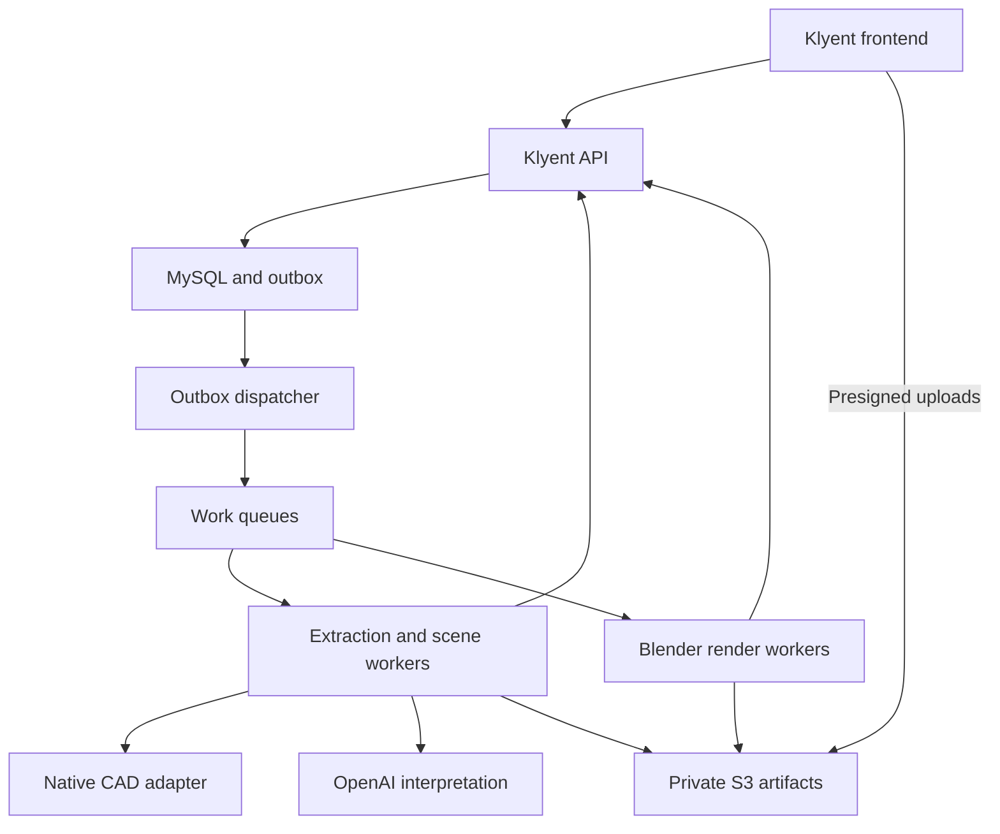

# Klyent: Dimension-Preserving 2D-to-3D Interior Design

## End-to-end architecture and implementation plan

**Prepared:** 13 November 2026  
**Application:** Existing Klyent TypeScript monorepo using npm workspaces  
**Primary database:** MySQL with mysql2 and Drizzle ORM  
**Delivery:** A new feature within Klyent, with isolated background workers  
**Document status:** Proposed implementation specification, not an audit of the existing source code

---

## Contents

1. [Recommended decision](#1-recommended-decision)
2. [Scope, outputs, and accuracy contract](#2-scope-outputs-and-accuracy-contract)
3. [Reuse and extension of the current stack](#3-reuse-and-extension-of-the-current-stack)
4. [Architecture and module boundaries](#4-architecture-and-module-boundaries)
5. [User journey and screens](#5-user-journey-and-screens)
6. [Upload, preflight, and file handling](#6-upload-preflight-and-file-handling)
7. [Drawing extraction and normalization](#7-drawing-extraction-and-normalization)
8. [Multi-drawing alignment and reconciliation](#8-multi-drawing-alignment-and-reconciliation)
9. [AI interpretation design](#9-ai-interpretation-design)
10. [Canonical scene and geometry generation](#10-canonical-scene-and-geometry-generation)
11. [MySQL data architecture](#11-mysql-data-architecture)
12. [API contracts](#12-api-contracts)
13. [Asynchronous workflow, reliability, and recovery](#13-asynchronous-workflow-reliability-and-recovery)
14. [Browser preview and final rendering](#14-browser-preview-and-final-rendering)
15. [Validation and fidelity gates](#15-validation-and-fidelity-gates)
16. [Security, privacy, and operational controls](#16-security-privacy-and-operational-controls)
17. [Deployment and infrastructure](#17-deployment-and-infrastructure)
18. [Observability, performance, and cost](#18-observability-performance-and-cost)
19. [Testing and benchmark dataset](#19-testing-and-benchmark-dataset)
20. [Phased implementation plan](#20-phased-implementation-plan)
21. [Implementation backlog](#21-implementation-backlog)
22. [First implementation milestone](#22-first-implementation-milestone)
23. [Risks and decisions to resolve during phase 0](#23-risks-and-decisions-to-resolve-during-phase-0)
24. [Source references and verification notes](#24-source-references-and-verification-notes)

## 1. Recommended decision

Build an assisted CAD-to-scene reconstruction system. Convert coordinated drawings into one validated, dimensioned 3D scene, then render all requested views from an immutable revision of that scene.

Reuse Klyent's React, Fastify, MySQL, Drizzle, S3, Three.js, validation, authentication, and UI infrastructure. Keep the browser renderer for interactive previews. Add a native CAD adapter and a Blender rendering worker for production outputs. OpenAI assists with interpretation and suggestions; it does not determine authoritative geometry.

The application must preserve all supported, specified design details and disclose everything that cannot be reconstructed. It must never silently fill missing dimensions, substitute furniture, omit unsupported entities, or alter the layout to make a render attractive.

The defensible product promise is:

> Reconstruct supported interior designs from coordinated drawings, verify them against source dimensions and designer decisions, and generate consistent views from the same approved 3D model.

It is not possible to guarantee complete reconstruction from every arbitrary JPEG or incomplete drawing set. A plan cannot establish unshown heights, cove sections, sofa profiles, or finishes. A realistic image is not evidence of dimensional accuracy.

### 1.1 Decisions fixed by this plan

| Area | Decision |
|---|---|
| Application | Extend Klyent; do not create a separate product or authentication system |
| Database | MySQL is the authoritative application database |
| File storage | Keep private AWS S3 storage and presigned uploads |
| Frontend | Keep React 18, Vite, Router, Tailwind, Radix, Zustand, React Query |
| Backend | Keep Fastify/TypeScript architecture; upgrade the unsupported Fastify 4 line before public production rollout |
| Browser rendering | Reuse Three.js, three-gpu-pathtracer, and three-mesh-bvh through an adapter |
| Production rendering | Blender/Cycles worker using a pinned runtime and controlled materials |
| CAD ingestion | ODA Drawings SDK adapter, subject to a real-file evaluation and suitable deployment license |
| Background messaging | Default to SQS Standard with a MySQL transactional outbox; reuse an existing durable queue instead if Klyent already operates one |
| AI | OpenAI structured interpretation with evidence and deterministic validation |
| Geometry authority | Versioned semantic scene, not generated images, browser state, or GLB files |
| Initial workflow | Assisted reconstruction, verification, approval, rendering |

These are architectural recommendations. No application files, lockfile, deployment configuration, or sample drawings were supplied for inspection. Audit those before choosing exact dependency versions or estimating migration work.

## 2. Scope, outputs, and accuracy contract

### 2.1 Supported project inputs

- DWG and DXF drawings, with supplied external references when applicable.
- Vector PDFs exported from CAD.
- JPEG/PNG and scanned PDFs through an assisted calibration and tracing workflow.
- Furniture plans, architectural dimensions, reflected ceiling plans, electrical layouts, wall elevations, sections, and detail sheets.
- Finish schedules, product references, and designer-supplied 3D furniture assets.

Multiple files can belong to one project, floor, room, discipline, and drawing revision. A file can contain multiple sheets or drawing viewports. Files are evidence; a coordinated drawing-set revision defines which evidence is authoritative for a scene.

### 2.2 Output package

| Output | Definition |
|---|---|
| Four perspective images | Four named wall-facing viewpoints per selected room; designer can adjust framing |
| Four wall elevations | Orthographic projections with optional dimensions; explicitly different from perspective images |
| Top cutaway | Orthographic overhead image with ceiling hidden by a saved visibility preset |
| Ceiling view | Ceiling-focused or reflected-ceiling projection using an explicit camera convention |
| Isometric view | Whole-room cutaway for spatial understanding |
| Interactive model | Browser navigation, object selection, measurements, source inspection |
| Downloadable model | GLB presentation model, plus optional Blender scene for authorized users |
| Validation report | Checked dimensions, unresolved issues, assumptions, approvals, source revisions |
| Presentation PDF | Selected images, view labels, model revision, and validation summary using existing PDF tooling |

Do not describe a presentation GLB as a fully editable CAD/BIM model. DWG, STEP, IFC, or fabrication output is a separate future scope requiring its own geometry and export requirements.

### 2.3 Strict and draft outputs

**Draft:** May contain placeholders or explicit provisional assumptions. Display an unmistakable draft label and a list of unresolved items. Draft export must retain that status.

**Verified final:** Every in-scope critical element has supported geometry, reconciled dimensions, resolved dependencies, and explicit approval where needed. A matching render manifest and validation run are required.

Unknown values remain null until resolved. If a designer supplies a missing value, record it as a designer decision, not as information extracted from a drawing. An approved substitute remains labeled as a substitute and must not be counted as an exact-source match.

### 2.4 Exclusions from the first production release

- Guaranteed automatic reconstruction of arbitrary low-quality scans.
- Structural engineering, electrical compliance certification, manufacturing tolerances, and construction sign-off.
- Automatically generating exact bespoke furniture from a top-view outline.
- Full BIM round-trip, MEP routing, multi-storey coordination, and live multi-user editing.
- Generative image enhancement of verified final renders.
- Unrestricted user scripts, uploaded Blender scripts, or LLM-generated geometry code execution.

## 3. Reuse and extension of the current stack

### 3.1 Frontend

| Existing component | Use in this feature | Required change |
|---|---|---|
| React 18 / Vite / Router | New project drawing and reconstruction routes | Lazy-load editor and rendering packages |
| Tailwind / Radix / CVA | Upload wizard, issue panels, asset picker, review dialogs | Reuse Klyent design tokens and components |
| Zustand | Selection, camera, tool mode, visibility, unsaved command state | Keep large mesh buffers outside reactive state |
| TanStack Query / Axios | Server revisions, jobs, catalogs, signed-upload flow | Query keys include project and revision |
| React Hook Form / Zod | Dimensions, calibration, materials, missing-information forms | Shared schemas with backend |
| Three.js | Interactive room editor and viewer | Scene adapter driven by canonical object IDs |
| three-gpu-pathtracer | Progressive high-quality browser preview | Pause while navigating; reset accumulation on relevant changes |
| three-mesh-bvh | Picking and geometry queries | Build/rebuild away from the UI thread where supported |
| Recharts | Admin quality, cost, and processing metrics | No requirement for charts in the design workflow |
| @react-pdf/renderer | Presentation and validation export | Server job for larger image-heavy reports |
| @huggingface/transformers | Optional local classification assistance | Capability-gated; never the only supported processing route |
| PWA | App shell and permitted lightweight caching | Do not broadly cache private originals or render downloads |
| Vitest | Domain, UI, and geometry tests | Add real drawing fixtures and end-to-end tests |

React Three Fiber is optional; it is not required to deliver this feature. Preserve the existing Three.js integration unless a code audit demonstrates a concrete benefit from changing it.

Pin compatible Three.js, path-tracer, BVH, and glTF tooling versions together. The path-tracer changelog documents API and minimum Three.js version changes; do not install its latest version independently into an existing renderer. [S3]

### 3.2 Backend and processing

| Component | Decision | Notes |
|---|---|---|
| Fastify / JWT / existing permissions | Reuse | Verify project authorization for every asset, job, event, and download |
| MySQL / mysql2 / Drizzle | Reuse | Add namespaced feature tables and reviewed migrations |
| S3 SDK and presigned URLs | Reuse | Direct browser upload; originals and derived artifacts stay private |
| OpenAI SDK | Reuse | Structured interpretation with source references and usage accounting |
| Tesseract.js | Reuse | Run OCR in dedicated CPU workers with bounded concurrency |
| mupdf | Reuse if licensing and installed API are suitable | Render pages, extract structured text, and investigate path-device extraction |
| pdf-parse | Supplemental text extraction | Do not rely on it alone for engineering geometry |
| @gltf-transform/core | Reuse | Model inspection and asset processing; not a CAD reconstruction engine |
| jszip | Reuse cautiously | Bound expanded size, file count, paths, and dependencies |
| mammoth / xlsx | Optional later schedule imports | Unnecessary for the first geometry milestone |
| Nodemailer | Reuse notification service | Completion notifications follow existing user preferences |
| New SQS SDK client | Add | Queue transport for TypeScript workers |
| Native CAD executable/service | Add | ODA-based DWG/DXF extraction behind a versioned adapter |
| Blender plus Python | Add | Trusted scene compiler and production renderer |
| OpenCV or equivalent | Conditional addition | Add for scan reconstruction only after basic calibration/tracing works |

No FastAPI service, PostgreSQL, vector database, or Redis is required by the default design. Python is initially confined to Blender automation; a later image-processing worker can use Python if it materially improves scan handling.

### 3.3 Version and licensing gates

Fastify 4's published LTS ended on 30 June 2025. Plan a compatible supported-major migration, including JWT, CORS, multipart, static, WebSocket, schema validation, and Node runtime testing. Existing feature work can begin behind flags while this migration is handled separately. [S1]

Preserve React 18 and the current frontend architecture initially. Audit the actual lockfile for supported versions and advisories rather than coupling this project to an unnecessary framework rewrite.

MuPDF.js is offered under AGPL and commercial agreements. Confirm the deployment's applicable license before expanding its use. Confirm ODA server/SaaS deployment rights and asset redistribution terms before committing vendors. These are procurement gates, not an assumption that installed packages are unusable. [S4, S5]

## 4. Architecture and module boundaries



Worker-to-API arrows represent authenticated result registration and job control, not public user endpoints. The control plane owns state transitions, approvals, and database writes. Workers receive scoped artifact access and submit results with a current lease token.

Keep normal HTTP requests short. Extraction, OCR, AI interpretation, mesh generation, final rendering, and packaging are asynchronous. Browser disconnects must not interrupt server jobs.

### 4.1 Suggested monorepo layout

| Path | Responsibility |
|---|---|
| `apps/frontend/src/features/interior-reconstruction/` | Routes, screens, hooks, review UI |
| `apps/frontend/src/features/interior-reconstruction/viewer/` | Existing renderer integration and scene adapter |
| `apps/backend/src/modules/interior/` | Route registration and feature services |
| `apps/backend/src/modules/interior/repositories/` | Tenant-scoped MySQL access |
| `apps/backend/src/modules/interior/workflows/` | Pipeline transitions, approvals, orchestration |
| `apps/backend/src/db/schema/interior/` | Drizzle tables and relationships |
| `apps/backend/drizzle/` | Reviewed migration files, following existing conventions |
| `apps/processing-worker/` | New TypeScript workspace: extraction, OCR, interpretation, scene compilation |
| `apps/outbox-dispatcher/` | Small TypeScript workspace/process for reliable dispatch |
| `packages/interior-contracts/` | Zod contracts, scene schemas, job and event envelopes |
| `packages/interior-geometry/` | Pure geometry, constraints, adapters, tolerance policy |
| `packages/interior-render-manifest/` | Renderer-neutral material, light, and camera definitions |
| `services/cad-adapter/` | Native ODA build, wrapper, and deployment image |
| `services/blender-worker/` | Pinned Blender image, Python compiler, worker entrypoint |
| `fixtures/interior/` | Licensed/sanitized test drawings, expected scenes, calibration cases |
| `infra/interior/` | Queue, S3 lifecycle, worker deployment, IAM, dashboards |

Only JavaScript/TypeScript packages become npm workspaces. Native CAD and Blender services use their own build tools and containers. Share contracts through generated JSON Schema fixtures and versioned manifests; Python must not import TypeScript runtime code.

### 4.2 Adapter contracts

Define stable internal interfaces for `DrawingExtractor`, `SemanticInterpreter`, `SceneCompiler`, `GeometryValidator`, `PreviewExporter`, and `FinalRenderer`. Each returns a schema version, implementation version, input digest, artifact references, warnings, and unsupported items.

This permits replacing ODA with an Autodesk adapter or changing a renderer without rewriting project management or the scene model. Autodesk's AutoCAD Automation API can execute custom DWG-processing add-ins/scripts; it is an alternative ingestion runtime, not a turnkey interior-reconstruction API. [S6]

## 5. User journey and screens

### 5.1 Entry point

Add an **Interior 3D** tab to an existing Klyent project. Reuse project ownership, organization membership, client links, and permissions. The user creates a reconstruction workspace and chooses the room/floor scope.

### 5.2 Screen requirements

| Screen | Main actions | Completion condition |
|---|---|---|
| Project overview | Start reconstruction, see drawing versions and job status | Project access verified |
| Upload and classify | Upload files, assign drawing type, room, revision, reference files | Required uploads pass preflight |
| Drawing review | Choose page/viewports, map layers, confirm units | Each selected drawing has a defined role |
| Align drawings | Pick anchors, overlay disciplines, choose authoritative source | Registration residuals reviewed |
| Resolve missing details | Answer concise dimension/material/product questions | Critical unknowns resolved or draft retained |
| Review reconstruction | Compare plan/elevations with 3D; inspect object provenance | Geometry corrections saved |
| Furniture and materials | Select exact products, upload assets, approve substitutions | Required assets and finishes resolved |
| Validation and approval | Inspect issues, deviations, source trace, approve revision | Final-render gate passes |
| Views and render | Set cameras, quality, visibility, submit render set | Immutable manifest queued |
| Render gallery | Download, compare revisions, create presentation PDF | Outputs complete and provenance visible |

### 5.3 Editor behavior

- Left area: source drawings, layer controls, room/object tree.
- Center: synchronized 2D source and 3D model, with split or single-view modes.
- Right area: selected object dimensions, materials, evidence, and unresolved issues.
- Bottom/status area: processing stage, current revision, save state, and warnings.
- Clicking a 3D object highlights its source region; selecting a source entity highlights corresponding objects.
- Distinguish extracted dimensions, designer decisions, and provisional assumptions visually and textually.
- Keep a manual tracing/editing fallback: walls, openings, profiles, dimensions, and asset placement.
- For elevation sheets, require assignment to a specific wall and orientation; do not guess left/right mapping.

### 5.4 Existing 3D designer integration

Audit Klyent's current scene serialization before adding a second model format. Introduce an adapter between legacy designer objects and the new canonical scene. Existing manually designed projects remain editable without claiming drawing verification.

Any manual edit to an approved reconstruction creates a new draft revision and invalidates affected approvals. Historical renders remain attached to their original revision. Undo/redo creates reversible commands; it does not mutate approved history.

## 6. Upload, preflight, and file handling

### 6.1 Direct upload protocol

1. Authenticated user requests an upload session for a project.
2. API checks membership, file limits, storage quota, and allowed input category.
3. API allocates a unique private S3 object key and returns constrained upload instructions.
4. Browser uploads directly to S3; use multipart upload where beneficial.
5. Browser calls complete. API verifies uploaded metadata, length, and checksum using authoritative object information.
6. Register an immutable document revision, preflight job, and outbox event in one transaction.
7. Worker validates file signatures, parses safely, and registers a manifest.
8. Failed uploads are visible with actionable errors; incomplete multipart uploads expire through lifecycle rules.

Do not assume an S3 ETag equals an MD5 digest. Record an explicit checksum and S3 version ID where bucket versioning is enabled. Never trust a browser-provided bucket key without checking it against the upload session.

### 6.2 Starting limits to benchmark

Use configurable pilot defaults: 100 MiB per CAD/PDF file, 30 MiB per raster file, 100 PDF pages, 100 megapixels decoded image size, and a bounded project upload total. These are product defaults, not library limits. Tune using actual design sets.

Archive limits must cover expanded bytes, file count, nesting, path traversal, and compression ratio. Referenced DWGs, images, fonts, and models must resolve only within the submitted package or an explicitly authorized project asset collection. Never follow arbitrary filesystem paths or remote URLs embedded in drawings.

### 6.3 Preflight results

Return document type, units found, model/paper spaces, pages/viewports, layer counts, bounds, text availability, unsupported entities, missing Xrefs/fonts, password protection, corrupted content, and estimated processing class.

An unreadable DWG or unsupported proxy object is a blocking issue when it affects the requested design. A rendered thumbnail is not proof that its geometry was extracted correctly.

## 7. Drawing extraction and normalization

### 7.1 DWG/DXF path

Implement a native CAD adapter that emits versioned neutral JSON/artifact files:

- Lines, polylines including bulges, arcs, circles, splines, hatches, and closed contours.
- Block definitions and instances, nested transforms, attributes, layer/style metadata.
- Dimensions, definition points, measured values, displayed text, text overrides, and dimension scale settings.
- Modelspace/paperspace/viewports, coordinate systems, drawing units, and clipping.
- External reference dependencies and stable entity identifiers where provided.
- Unsupported/proxy entity records with bounding regions and visible previews where possible.

Preserve raw geometry alongside interpreted objects. A block called SOFA is a useful hint, not proof of an exact manufacturer model. A closed polygon is not automatically a wall. Layers and legends establish meaning only after mapping and validation.

Do not flatten all source entities to straight lines permanently. Keep analytic curves/profiles; tessellate only for preview/rendering with recorded error bounds. Dimension text can override measured geometry, so preserve and reconcile both. [S7]

### 7.2 Vector PDF path

Use the existing MuPDF integration to render previews and extract positioned text. Prototype vector extraction using the installed JavaScript device/path interfaces; pin and test the specific API version. MuPDF documents path-device operations, but a complete CAD interpretation layer still has to be built. [S8]

PDF normalization must account for crop/media boxes, page rotation, clipping, graphics transforms, visible layers, stroke width, and the coordinate origin. Keep annotations and dimension lines separate from physical outlines.

Each drawing viewport receives its own scale and registration transform. A single sheet may mix a 1:50 plan with a 1:5 detail. A printed scale label is supporting evidence; verify against dimensions because exported or printed PDFs may have been resized.

### 7.3 Raster/scanned PDF path

1. Decode in an isolated process; detect rotation and scan distortion.
2. Render or crop at a suitable resolution while retaining the original-to-crop transform.
3. Use Tesseract.js for text and dimension candidates.
4. Ask the designer to select known dimensions or control points.
5. Identify candidate lines, contours, openings, and symbols.
6. Present a tracing overlay with uncertainty and editable endpoints.
7. Require confirmation of critical dimensions before final reconstruction.

For a clean undistorted scan, a two-point known distance can establish a scale, but additional independent anchors are needed to verify rotation and consistency. Affine correction needs sufficient non-collinear correspondences; perspective rectification needs at least four suitable planar point correspondences. Reject arbitrary warping that merely forces conflicting drawings to match.

Raster uncertainty comes from pixel resolution, line thickness, compression, and deformation. A high-resolution image does not create missing dimensions. Initial raster support should prioritize calibration and assisted tracing over speculative automatic reconstruction.

### 7.4 Dimension parser

Support millimeters, centimeters, meters, decimal feet, feet/inches, and fractional inches. Preserve original text and parsed values. Examples: `9'-6\"` is 2,895.6 mm; `2'-0\"` is 609.6 mm. Distinguish length, angle, radius, diameter, level, quantity, and specification numbers.

Reject ambiguous syntax and unitless values when drawing units are unknown. Test OCR confusions such as 0/O, 1/I, missing decimal points, and feet/inch marks. A model suggestion is not sufficient to silently correct a critical dimension.

## 8. Multi-drawing alignment and reconciliation

### 8.1 Coordinate convention

Canonical design space uses millimeters, a right-handed coordinate system, X/Y on the floor plane, and positive Z upward. Finished floor level is the local elevation datum. Use room-local origins where possible; preserve building/project transforms separately.

Declare matrices as column-major 4×4 matrices acting on column vectors. Store source-to-project, room-to-project, and viewport transforms explicitly. Do not infer conventions from library defaults.

- Canonical to Three.js/glTF meters: `(x, y, z) -> (x/1000, z/1000, -y/1000)`.
- Canonical to Blender meters: `(x, y, z) -> (x/1000, y/1000, z/1000)`.
- Apply the same rotation and unit policy to geometry, normals, cameras, light directions, and annotation anchors.

Keep computations in double precision and serialize consistently. Database DECIMAL precision is storage precision, not a claim about drawing accuracy. GPU meshes are derived representations and may have different numeric precision.

### 8.2 Registration workflow

1. Choose an architectural plan as the initial reference, subject to designer confirmation.
2. Match common wall corners, columns, openings, and dimension chains.
3. Estimate a rigid or similarity transform where justified.
4. Calculate residuals against anchors not used to fit the transform.
5. Show overlays, maximum deviation, and scale/rotation changes.
6. Ask the designer to confirm or adjust anchors when ambiguous.
7. Freeze the approved transforms into the drawing-set revision.

Reflected ceiling plans typically share plan locations but require explicit orientation verification; do not mirror them automatically because the word reflected appears. Elevations map through a wall-local horizontal axis and a vertical level datum. Sections need an identified section plane and viewing direction.

### 8.3 Conflict types and resolution

| Conflict | Required handling |
|---|---|
| Geometry length differs from displayed dimension | Show both and request authoritative value |
| Different revisions contain different walls | Select an authoritative coordinated drawing set |
| Ceiling boundary intersects an opening unexpectedly | Flag geometric clash; do not auto-trim without approval |
| Electrical and ceiling plans disagree on fixture position | Surface both source regions and proposed resolution |
| Furniture dimensions differ from approved asset | Require exact asset, parametric adjustment, or explicit substitution |
| Height or detail is absent | Request dimension/detail or keep a draft placeholder |
| Scaled PDF disagrees with CAD | Preserve discrepancy and prefer only the explicitly approved authority |

Store each resolution as a decision with actor, timestamp, affected objects, old/new values, rationale, and source references. Never globally apply a rule such as CAD always wins or latest upload always wins.

### 8.4 Cross-sheet object identity

A light shown in both the electrical plan and ceiling plan normally represents one physical fixture. Build candidate matches from registered location, symbol/product type, room, labels, and drawing role. Link multiple evidence records to the same scene object after deterministic checks or review. Proximity alone must not merge distinct adjacent fixtures. Likewise, an elevation representation of a cabinet enriches the plan object rather than creating a second cabinet.

Model dimensional relationships as a constraint graph: equality, distance, angle, parallel/perpendicular, coincidence, containment, and level relationships. Preserve locked authoritative measurements. Detect underconstrained objects and overconstrained/conflicting dimension chains. A solver may propose adjustments to provisional geometry within declared uncertainty, but must not silently alter approved dimensions to obtain a solution.

## 9. AI interpretation design

### 9.1 Allowed responsibilities

Use OpenAI for sheet classification, legend interpretation, layer/block suggestions, note extraction, material normalization, evidence-backed object labels, catalog shortlisting, and explanations of missing/conflicting information.

Provide structured CAD/text data first. Supply targeted drawing crops when visual context is needed. Include stable source IDs and crop transforms. Avoid sending every large sheet repeatedly.

### 9.2 Forbidden authority

AI cannot approve its own inferred dimensions, overwrite locked constraints, silently choose source revisions, execute generated scripts, or turn unsupported furniture into an exact-match asset. Document notes are data, not executable instructions.

OpenAI documents limitations involving precise spatial localization and visual interpretation. Structured outputs constrain response shape, not truthfulness or physical correctness. Both semantic and numerical validation remain mandatory. [S9, S10]

### 9.3 Suggested result contract

```typescript
type InterpretationCandidate = {
  candidateId: string;
  kind: 'wall' | 'opening' | 'furniture' | 'ceiling' | 'panel' | 'light' | 'unknown';
  sourceRefs: Array<{
    documentRevisionId: string;
    viewportId: string;
    entityIds: string[];
    cropArtifactId: string | null;
  }>;
  proposedProperties: Record<string, unknown>;
  missingProperties: string[];
  confidence: number;
  rationale: string;
};
```

The actual API schema must replace the illustrative unrestricted property map with bounded, typed, per-kind schemas. Validate evidence IDs against the supplied input set; reject invented IDs. Set missing fields to null where the schema requires explicit presence. Handle refusals, truncation, invalid responses, and provider timeouts.

Model confidence is an uncalibrated suggestion until benchmarked. Do not display it as dimensional accuracy. Automatic acceptance can apply to low-risk classification after evaluation; dimensions and geometry follow separate evidence rules.

### 9.4 Cost and latency controls

- Deterministic extraction before AI.
- Cache by tenant, input content hash, prompt version, schema version, and model identifier.
- Batch related notes from one drawing context without exceeding configured limits.
- Use a smaller validated model for classification and a stronger one only for ambiguity.
- Keep exact model names/configuration outside domain code; evaluate against the same fixture suite before changes.
- Log token usage, latency, correction rate, and provider request ID without copying private drawing text into generic logs.
- Reserve a per-job AI budget and stop for review rather than retrying indefinitely.

## 10. Canonical scene and geometry generation

### 10.1 Scene contract

The semantic scene is the source of truth. Store editable object parameters in MySQL, then freeze a canonical snapshot in S3 with a checksum. GLB, Blender files, thumbnails, and images are derived artifacts. Keep source evidence and dimensional constraints independently accessible.

```typescript
type Vec3 = [number, number, number];
type Quaternion = [number, number, number, number]; // x, y, z, w

interface InteriorScene {
  schemaVersion: string;
  tenantId: string;
  projectId: string;
  revisionId: string;
  drawingSetRevisionId: string;
  units: 'mm';
  axes: 'RH_Z_UP';
  rooms: RoomDefinition[];
  objects: SceneObject[];
  constraints: DimensionConstraint[];
  materials: MaterialVersionRef[];
  assetVersions: AssetVersionRef[];
}

interface SceneObject {
  objectId: string;
  roomId: string;
  parentId: string | null;
  kind: string; // Runtime discriminated union required.
  transform: { positionMm: Vec3; rotation: Quaternion };
  geometry: GeometryDefinition; // Versioned, typed per object kind.
  materialBindings: MaterialBinding[];
  provenance: PropertyEvidence[];
  verification: 'unresolved' | 'provisional' | 'verified';
}
```

Referenced types above are domain contracts to implement, not existing Klyent types. Use discriminated Zod unions, bounded arrays, finite numeric checks, valid polygon rules, and an acyclic parent hierarchy. Validate normalized quaternions, reference existence, material slots, and source scope.

Evidence is property-level: an object's width may come from a plan, height from an elevation, depth from a section, and finish from a designer decision. A single object confidence value loses this distinction.

### 10.2 Geometry families

| Family | Parameters and modeling rule |
|---|---|
| Walls | Footprint or reference path, thickness, height profile, base level, finish offsets; resolve intersections explicitly |
| Openings | Host wall, local position, width, height, sill/head level, frame profile, swing/orientation |
| Floors | Boundary loops with holes, level, thickness, material region, pattern origin |
| Ceiling zones | Outer/inner loops, level, thickness, stepped profiles, suspension/drop metadata |
| Cove/POP details | Sweep path, section profile, start/end conditions, recess depth, light channel |
| Wall paneling | Wall-local extents, panel divisions, groove profiles, depth, trims, material orientation |
| Joinery | Parametric carcass/front/partition dimensions, shutters, handles, reveals and plinths |
| Furniture | Exact asset version or a supported parametric family with approved configuration |
| Fixtures | Exact mounting point, local axes, dimensions, cutout, asset and photometric references |
| Curved elements | Analytic curves plus controlled tessellation and section profiles |

Prefer profile extrusion/sweeps and robust polygon operations for supported families. Do not use repeated fragile mesh booleans for every wall/opening. Introduce a robust geometry kernel only when demonstrated cases exceed the simpler approach, and test its deployment/license before adoption.

Compile geometry once into a versioned geometry bundle consumed by both preview and final-render adapters. Blender should assemble this approved geometry and renderer-specific materials/lights, rather than independently reinterpreting the drawing or rebuilding dimensions with different rules. Higher-quality tessellation must come from the same analytic scene and remain within the recorded chord-error tolerance.

### 10.3 Geometry requirements

- Validate closed loops, holes, self-intersections, winding, near-duplicate points, and minimum features.
- Distinguish a measured finished-face dimension from wall centerline or structural-face dimensions.
- Distinguish an object's local dimensions from its rotated world-axis bounding box.
- Preserve panel divisions and visible grooves as geometry when depth affects the result.
- Use draft placeholder meshes only while the object is unresolved.
- Do not resize a room, remove objects, or widen camera-facing walls to improve framing.
- Store object IDs in mesh metadata for picking and source traceability.
- Quantization, simplification, or texture compression must be quality-tier specific; do not change the authoritative scene.

### 10.4 Furniture and materials

Maintain versioned asset families with category, product/SKU, native dimensions, pivot, front/up axes, materials, LODs, texture manifest, provenance, and license/use permissions.

Asset selection order: exact referenced product; supplied approved asset; supported parametric family; designer-approved substitute. A footprint match alone is insufficient. Non-uniform scaling of upholstered furniture or detailed manufactured products requires explicit approval and should normally be rejected.

For custom furniture, expose typed parameters for supported families. If a design lies outside those families, accept a reviewed custom model or show an unsupported-detail issue. Full arbitrary furniture modeling is a separate capability.

Material definitions should include base color, roughness, metallic, normal/bump, transmission where relevant, texture scale in physical units, UV origin/orientation, and finish reference. A material photo may guide selection but is not a calibrated color measurement. Finish samples remain subject to designer/client confirmation.

Light definitions should include mounting level, direction, fixture dimensions, color temperature, output, beam/photometric reference, and on/off state. Distinguish the visible fixture mesh from the actual emitter. Missing light output can use a clearly labeled draft preset but cannot be claimed as an exact physical simulation.

## 11. MySQL data architecture

### 11.1 Storage rules

- Use InnoDB, UTF-8 (`utf8mb4`), and consistent UTC timestamps such as `DATETIME(3)`.
- Reuse Klyent's existing ID type and tenant/project tables. Examples here use UUID strings for readability; do not create a competing tenant system.
- Namespace new feature tables with `int_` unless the repository already has a naming convention.
- Store searchable ownership, status, revision, dates, and dimensions in typed columns.
- Use JSON for bounded typed geometry/property payloads, not for all application relationships.
- Store large CAD extraction payloads, scene snapshots, meshes, textures, and renders in S3.
- Use `DECIMAL(18,6)` where stable decimal dimension persistence is needed; retain decimal strings at the mysql2 boundary and convert through a checked domain adapter.
- Keep explicit units in the contract even when every normalized measurement is in millimeters.
- Add optimistic concurrency counters; never use timestamps alone as edit-conflict detection.

MySQL does not index JSON columns directly as ordinary scalar columns. Promote frequently filtered fields into normal columns, or use deliberately chosen generated-column/index patterns supported by the deployed version. [S11]

Target a supported MySQL release, preferably 8.4 LTS for a new deployment after compatibility testing. If Klyent already uses another maintained MySQL version, validate feature compatibility first; upgrading the database is not automatically required to begin the feature.

### 11.2 Core drawing and scene tables

All project-owned tables carry `tenant_id` and `project_id`. Foreign keys must preserve scope: use referenced unique keys including tenant/project where appropriate, plus service authorization. MySQL does not supply the application's tenant authorization automatically.

| Table | Important columns | Constraints/indexes |
|---|---|---|
| `int_workspaces` | id, tenant_id, project_id, name, active_draft_id, approved_revision_id, created_by, lock_version | Unique tenant/project/id; project listing index |
| `int_upload_sessions` | id, tenant_id, project_id, object_key, expected_type, max_bytes, checksum, expires_at, status | Unique object_key; expiration/status cleanup index |
| `int_documents` | id, workspace_id, title, discipline, logical_drawing_code, room_scope | Workspace/title listing; stable identity across revisions |
| `int_document_revisions` | id, document_id, revision_no, artifact_id, source_revision_label, checksum, preflight_status, parser_version | Unique document/revision_no within scope; immutable original reference |
| `int_drawing_viewports` | id, document_revision_id, page_index, viewport_bounds_json, drawing_kind, units, metadata_json | Revision/page index |
| `int_drawing_sets` | id, workspace_id, revision_no, status, approved_by, approved_at | Unique workspace/revision_no |
| `int_drawing_set_members` | drawing_set_id, viewport_id, role, room_id, authority_json | Unique set/viewport; scoped references |
| `int_registrations` | id, drawing_set_id, viewport_id, transform_json, anchors_json, residual_mm, verification_status | Unique set/viewport; preserve registration version in frozen sets |
| `int_rooms` | id, workspace_id, logical_key, name | Stable identity; geometry lives in scene revisions |
| `int_scene_revisions` | id, workspace_id, parent_revision_id, revision_no, drawing_set_id, status, lock_version, sealed_at, schema_version, snapshot_artifact_id, scene_hash | Unique workspace/revision_no; workspace/status index |
| `int_scene_objects` | scene_revision_id, object_id, room_id, parent_object_id, kind, transform_json, geometry_json, verification_status, local_bounds_json | Composite PK revision/object; revision/room/kind index |
| `int_object_evidence` | id, scene_revision_id, object_id, property_path, document_revision_id, viewport_id, entity_ref, source_region_json, original_text, normalized_value_json, evidence_kind, decision_id | Revision/object/property index; scoped revision/object FK |
| `int_constraints` | id, scene_revision_id, constraint_kind, object_refs_json, expected_value, unit, tolerance, authority, source_ref_json | Revision/kind; deterministic validation of references |
| `int_decisions` | id, workspace_id, scene_revision_id, actor_id, decision_kind, before_json, after_json, rationale, evidence_json, created_at | Revision/time index; append-only |

Source entity references may point into an immutable extraction artifact rather than individual MySQL rows. Store a compact lookup manifest to locate source regions efficiently. Do not insert every raw PDF segment into MySQL unless measurements show a real query need.

### 11.3 Assets, validation, and delivery tables

| Table | Important columns | Constraints/indexes |
|---|---|---|
| `int_assets` | id, owner_namespace, owner_tenant_id, category, name, product_code, visibility | Permission-filtered category/product lookup |
| `int_asset_versions` | id, asset_id, revision_no, model_artifact_id, dimensions_json, axes_json, parameter_schema_json, license_ref, approved_status | Unique asset/revision_no; immutable approved versions |
| `int_material_versions` | id, material_id, revision_no, properties_json, texture_manifest_artifact_id, physical_scale_json | Unique material/revision_no; immutable |
| `int_scene_bindings` | scene_revision_id, object_id, binding_kind, slot_name, asset_version_id, material_version_id, configuration_json | Revision/object/slot uniqueness; exactly valid target enforced |
| `int_validation_runs` | id, scene_revision_id, validator_version, input_hash, policy_json, status, summary_json, report_artifact_id | Revision/input_hash/version index |
| `int_validation_issues` | id, run_id, object_id, severity, code, expected_json, observed_json, deviation, source_refs_json, resolution_decision_id | Run/severity/code; never overwrite historical issues |
| `int_approvals` | id, scene_revision_id, validation_run_id, scene_hash, scope_json, approved_by, approved_at | Revision/approval index; tied to immutable inputs |
| `int_view_presets` | id, scene_revision_id, room_id, name, camera_json, visibility_json | Revision/room; render manifest embeds immutable values |
| `int_render_sets` | id, scene_revision_id, approval_id, manifest_artifact_id, render_hash, quality, status, requested_by | Revision/created_at; scoped unique request key |
| `int_render_outputs` | id, render_set_id, view_key, status, job_id, artifact_id, metadata_json | Unique render_set/view_key/format |
| `int_artifacts` | id, tenant_id, project_id, kind, bucket, object_key, object_version, sha256, size_bytes, mime_type, lifecycle_status | Unique artifact identity; scope/kind/time index |
| `int_jobs` | id, tenant_id, project_id, job_type, input_hash, idempotency_key, status, attempt, max_attempts, lease_token, lease_expires_at, cancel_requested_at, available_at, input_artifact_id, result_artifact_id, error_code | Tenant/idempotency unique; status/available_at; project/time |
| `int_job_dependencies` | job_id, prerequisite_job_id, required_status | Composite unique key; cycle prevention in service |
| `int_outbox` | id, aggregate_id, topic, payload_json, published_at, claim_token, lease_expires_at, attempt, available_at | Unpublished/available index; scoped aggregate reference |
| `int_events` | id, workspace_id, job_id, sequence_no, event_type, payload_json, created_at | Workspace/sequence unique for reconnect |
| `int_usage_records` | id, job_id, provider, unit_type, units, estimated_cost, actual_cost, rate_version, created_at | Job/provider; tenant/month reporting |

Reuse existing audit and notification tables if they already support the required actor, project, and correlation fields. Do not duplicate them solely to follow this table list.

Shared catalog assets require explicit access rules; avoid making `tenant_id = NULL` mean accessible to everyone. Use an explicit system/catalog namespace and grants. A project scene must pin approved asset versions, even if the global catalog later changes.

### 11.4 Representative MySQL DDL

This excerpt demonstrates keys and revision handling. It is not a complete migration. Adapt ID types, parent names, FKs, status checks, timestamp defaults, and Drizzle definitions to the actual repository.

```sql
CREATE TABLE int_scene_revisions (
  id CHAR(36) CHARACTER SET ascii COLLATE ascii_bin NOT NULL,
  tenant_id CHAR(36) CHARACTER SET ascii COLLATE ascii_bin NOT NULL,
  project_id CHAR(36) CHARACTER SET ascii COLLATE ascii_bin NOT NULL,
  workspace_id CHAR(36) CHARACTER SET ascii COLLATE ascii_bin NOT NULL,
  revision_no INT UNSIGNED NOT NULL,
  status VARCHAR(32) NOT NULL,
  lock_version INT UNSIGNED NOT NULL DEFAULT 0,
  schema_version VARCHAR(32) NOT NULL,
  scene_hash CHAR(64) CHARACTER SET ascii COLLATE ascii_bin NULL,
  snapshot_artifact_id CHAR(36) CHARACTER SET ascii COLLATE ascii_bin NULL,
  sealed_at DATETIME(3) NULL,
  created_at DATETIME(3) NOT NULL DEFAULT CURRENT_TIMESTAMP(3),
  PRIMARY KEY (id),
  UNIQUE KEY uq_scene_scope (tenant_id, project_id, id),
  UNIQUE KEY uq_scene_revision
    (tenant_id, project_id, workspace_id, revision_no),
  KEY ix_scene_status (tenant_id, project_id, workspace_id, status)
) ENGINE=InnoDB DEFAULT CHARSET=utf8mb4;

CREATE TABLE int_scene_objects (
  tenant_id CHAR(36) CHARACTER SET ascii COLLATE ascii_bin NOT NULL,
  project_id CHAR(36) CHARACTER SET ascii COLLATE ascii_bin NOT NULL,
  scene_revision_id CHAR(36) CHARACTER SET ascii COLLATE ascii_bin NOT NULL,
  object_id CHAR(36) CHARACTER SET ascii COLLATE ascii_bin NOT NULL,
  room_id CHAR(36) CHARACTER SET ascii COLLATE ascii_bin NOT NULL,
  kind VARCHAR(48) NOT NULL,
  transform_json JSON NOT NULL,
  geometry_json JSON NOT NULL,
  verification_status VARCHAR(24) NOT NULL,
  PRIMARY KEY (scene_revision_id, object_id),
  KEY ix_objects_room
    (tenant_id, project_id, scene_revision_id, room_id, kind),
  CONSTRAINT fk_objects_scene_scope
    FOREIGN KEY (tenant_id, project_id, scene_revision_id)
    REFERENCES int_scene_revisions (tenant_id, project_id, id)
) ENGINE=InnoDB DEFAULT CHARSET=utf8mb4;
```

The service must lock/check the parent revision before every mutation and reject writes once sealed. Referential integrity alone does not enforce immutability or authorization. Avoid broad cascade deletes across historical revisions; use an authorized deletion workflow with reference-aware artifact cleanup.

### 11.5 Draft edits and freezing

1. Client submits typed commands with `baseLockVersion`.
2. Transaction checks tenant/project permission and locks the draft revision row.
3. Reject if sealed or if lock version differs; return `409 REVISION_CONFLICT` with current revision metadata.
4. Validate and apply commands; update objects, evidence, decisions, and constraints atomically.
5. Increment lock version, invalidate current draft validation, and write the outbox event in that transaction.
6. A freeze request seals the draft under the same lock and queues snapshot/mesh compilation.
7. Workers read only sealed data, create content-addressed artifacts, and register hashes.
8. Validation completes on that exact hash; approval references that validation run.
9. Further edits clone a new draft with a parent revision reference.

Do not hold a MySQL transaction open during S3 upload, OpenAI calls, CAD processing, or rendering. Artifacts uploaded before a failed registration remain unreferenced and are cleaned after a grace period.

### 11.6 Migrations and indexing

Use Drizzle's mysql2 integration and repository-compatible schema definitions. Generate and review SQL migrations, then apply them through a single release migration job. Do not run `drizzle-kit push` automatically in production. Drizzle documents mysql2 support and migration workflows. [S12]

Use expand/migrate/contract changes for populated tables. Backfill in batches, inspect query plans, and avoid large locks. Test restore and forward-fix procedures; MySQL DDL is not generally an application transaction that can simply be rolled back with data writes.

## 12. API contracts

Suggested prefix: `/api/v1/projects/:projectId/interior`. Adapt to Klyent's existing routing convention. Derive tenant scope from authenticated membership; do not accept client-provided tenant IDs as authorization.

### 12.1 Public application endpoints

| Method | Relative route | Purpose |
|---|---|---|
| POST | `/workspaces` | Create a reconstruction workspace |
| GET | `/workspaces/:workspaceId` | Workspace summary and current revisions |
| POST | `/uploads` | Allocate an upload session and signed upload instructions |
| POST | `/uploads/:uploadId/complete` | Verify upload and queue preflight |
| GET | `/documents` | Paginated document/revision inventory |
| GET | `/documents/:documentId/revisions/:revisionId` | Preflight and viewport metadata |
| POST | `/drawing-sets` | Create coordinated set of selected drawing revisions/viewports |
| POST | `/drawing-sets/:setId/registrations` | Save calibration/registration proposal |
| POST | `/drawing-sets/:setId/seal` | Freeze confirmed source selection/transforms |
| POST | `/reconstructions` | Start extraction/interpretation/build workflow |
| GET | `/revisions/:revisionId` | Scene summary, artifact references, validation status |
| GET | `/revisions/:revisionId/objects` | Room-filtered paginated semantic objects |
| POST | `/revisions/:revisionId/commands` | Apply validated draft edit batch |
| POST | `/revisions/:revisionId/freeze` | Seal draft and compile immutable artifacts |
| POST | `/revisions/:revisionId/validations` | Validate frozen scene under named policy |
| GET | `/revisions/:revisionId/issues` | Paginated issues and evidence |
| POST | `/revisions/:revisionId/approvals` | Approve exact validated revision and scope |
| POST | `/revisions/:revisionId/fork` | Create editable draft from historical revision |
| GET | `/assets` | Permission-filtered catalog search |
| POST | `/assets` | Register custom asset ingestion |
| POST | `/render-sets` | Queue camera/view outputs for an approved or explicit draft revision |
| GET | `/render-sets/:renderSetId` | Per-view status, provenance, and download availability |
| POST | `/render-sets/:renderSetId/exports` | Produce PDF/ZIP/model package |
| GET | `/jobs/:jobId` | Durable processing state |
| POST | `/jobs/:jobId/cancel` | Request cooperative cancellation |
| POST | `/jobs/:jobId/retry` | Authorized retry for eligible failures |
| GET | `/events` | Durable events after a cursor |
| GET | `/artifacts/:artifactId/download` | Authorize and return short-lived download URL |

Use existing WebSocket support for live progress, plus the event cursor endpoint for reconnect/recovery. Validate subscription scope and reauthenticate according to the existing session model. Never broadcast project events through an unscoped global channel.

### 12.2 Example reconstruction request

```json
{
  "workspaceId": "workspace-id",
  "drawingSetRevisionId": "drawing-set-id",
  "roomIds": ["living-room-id"],
  "mode": "strict",
  "allowProvisionalDraft": true,
  "interpretationProfile": "interior-default-v1"
}
```

Strict mode controls authority and final approval. `allowProvisionalDraft` permits an explicitly labeled intermediate result; it must not weaken final-render gates.

Return `202 Accepted` with workflow/job IDs and status URL. No HTTP request should wait for conversion completion.

### 12.3 Command example

```json
{
  "baseLockVersion": 12,
  "commands": [
    {
      "type": "set_ceiling_level",
      "objectId": "ceiling-zone-id",
      "finishedUndersideLevelMm": 2700,
      "evidence": {
        "kind": "designer_decision",
        "reason": "Confirmed from section A-A",
        "documentRevisionId": "section-revision-id"
      }
    }
  ]
}
```

Provide allowlisted semantic commands rather than unrestricted JSON patches that can modify ownership, approvals, or arbitrary object internals. The backend recomputes dependent geometry and identifies invalidated checks.

### 12.4 Request safety and response semantics

- Require an idempotency key on workflow creation, render requests, and other expensive repeatable mutations.
- Store the key with a request-body hash; same key plus different body returns a conflict.
- Return stable error codes such as `MISSING_SCALE`, `UNRESOLVED_XREF`, `DIMENSION_CONFLICT`, `UNSUPPORTED_ENTITY`, `APPROVAL_REQUIRED`, and `REVISION_CONFLICT`.
- Include retryability and next action without leaking internal file paths or provider secrets.
- Use cursor pagination for documents, assets, objects, jobs, and events.
- Downloads are authorized at request time; artifact ownership is never inferred from its S3 key alone.

## 13. Asynchronous workflow, reliability, and recovery

### 13.1 Pipeline stages

`preflight → extraction → interpretation → registration/review → scene compilation → validation → approval → rendering → export`

Stages are a dependency graph, not a single long-running request. Per-file extraction and per-view rendering can run concurrently; dependent stages wait for registered prerequisites. Human review is a durable waiting state, not a worker consuming resources while waiting.

Suggested queues: `interior-cpu`, `interior-cad`, `interior-ai`, `interior-render`, and `interior-export`. Start with fewer physical queues if operating volume is small, but keep job types and resource classes distinct.

### 13.2 Reliable publication

Write the job and outbox record in the same MySQL transaction. After commit, signal the dispatcher for quick delivery. A periodic bounded sweep recovers missed signals. Claim outbox rows in short transactions, release the transaction before network calls, and publish at least once.

The outbox sweep is an operational recovery mechanism; the application does not poll every project row each second. Workers wait on the queue. SQS long polling supports waits up to 20 seconds, reducing empty receive traffic. [S13]

If publication succeeds but marking the outbox row fails, the message may be sent again. Consumers must tolerate this. Exactly-once execution is not assumed.

SQS Standard explicitly uses at-least-once delivery; persist idempotency in MySQL rather than relying on a queue message being received only once. [S17]

### 13.3 Worker protocol

1. Receive a small queue message containing job ID, input artifact/hash, schema version, and resource class; no large CAD payload.
2. Claim the job through an authenticated internal API using an atomic state transition.
3. Obtain a lease token and short-lived artifact access.
4. Verify input hashes and runtime compatibility.
5. Run the bounded process, periodically renewing the lease and queue visibility.
6. Upload outputs under a job-attempt-specific prefix.
7. Submit results with lease token, hashes, metrics, and output manifest.
8. Control plane accepts results only for the current attempt and non-canceled state.
9. Acknowledge/delete the message only after durable result registration.

Queue visibility and job lease durations must accommodate heartbeat cadence and processing duration. AWS documents visibility configuration; a too-short timeout increases duplicate processing. [S14]

### 13.4 Status model

Jobs: `queued`, `running`, `retry_wait`, `succeeded`, `failed`, `cancel_requested`, `canceled`.

Reconstruction workflow: `processing`, `needs_review`, `draft_ready`, `validating`, `blocked`, `ready_for_approval`, `approved`.

Render set: `queued`, `running`, `partially_complete`, `complete`, `failed`, `canceled`.

Keep status separate from progress. A stage can be running without a reliable percent estimate. Show stage names, completed item counts, and queue position/ETA only when backed by measurements.

### 13.5 Retry and cancellation rules

- Retry transient provider/network/worker failures with bounded exponential backoff and jitter.
- Do not retry corrupt inputs, missing dimensions, unsupported geometry, or rejected approvals without changed input.
- Move repeatedly failing messages to a dead-letter queue and expose an operator action.
- Cancellation stops new child jobs, requests cooperative process termination, and prevents stale completion from publishing final output.
- Expired workers cannot commit results after a replacement attempt takes the lease.
- Reuse valid completed views when one render view fails; retry only failed/incomplete view jobs.
- Record provider call attempts to understand costs when a network failure makes AI billing status uncertain.

### 13.6 Fairness and resource management

Limit concurrent jobs per tenant, project, worker pool, and provider. Use admission controls and a dispatcher policy so one large project cannot starve smaller ones. SQS Standard ordering is not a fairness policy by itself.

Reserve render capacity based on estimated VRAM and scene size. Start with one heavy render per GPU, then benchmark. Do not autoscale CPU-only nodes for GPU work. Break long render sets into camera-sized jobs within provider lease limits.

## 14. Browser preview and final rendering

### 14.1 Browser preview tiers

| Tier | Renderer behavior | Use |
|---|---|---|
| Interactive | Rasterized Three.js scene with bounded textures/LOD | Modeling, selection, calibration review |
| Quality preview | Existing path tracer progressively accumulates samples | Materials and lighting inspection while camera is stationary |
| Final | Server-rendered approved scene using Blender/Cycles | Client presentation and saved multi-view package |

Capability-detect the browser renderer and use a raster fallback. Do not assume a particular WebGPU/WebGL mode exists in the installed path-tracer version. Test the supported device/browser matrix explicitly. [S2, S3]

Cancel obsolete mesh builds and release GPU resources when switching projects. Load one room/zone at a time for large projects. Limit texture sizes, reuse geometry/materials, and avoid rebuilding the entire scene for a selection change. Material edits or camera movement should reset only the appropriate preview accumulation state.

### 14.2 Production render manifest

The immutable render manifest must include:

- Scene revision, scene hash, approval ID, and validation run ID.
- Geometry bundle hashes and exact asset/material/texture versions.
- Camera position, orientation, projection, sensor/focal settings, clipping, resolution, and aspect ratio.
- Room scope and explicit visibility/cutaway rules.
- Lighting configuration, environment asset, exposure, and color-management settings.
- Renderer image digest, Blender version, compiler version, sampling, denoising, and seed settings.
- Output formats and view names.

Hash the complete manifest. A cache key based only on scene geometry would incorrectly reuse results after material, lighting, camera, or renderer changes.

### 14.3 Render worker

1. Claim the render-view job and retrieve the manifest.
2. Check final approval or explicit draft status.
3. Download verified geometry and assets into an isolated temporary directory.
4. Assemble the scene with trusted Python code, mapping materials through a tested adapter.
5. Validate object transforms, geometry bounds, camera, and required resources.
6. Run Blender in background mode with a pinned Cycles configuration.
7. Generate image plus metadata and, where useful, depth/normal/object-ID passes for QA.
8. Check file integrity, expected dimensions, missing textures, and obvious empty/failed output.
9. Upload artifacts and register completion under the current lease.
10. Delete temporary data and release GPU resources.

Cycles is a physically based production renderer; final visual quality still depends on modeling, materials, light data, and camera configuration. [S15]

Do not load arbitrary uploaded `.blend` files with scripting enabled. Prefer ingested geometry/assets through the controlled asset pipeline. A future Blender import feature needs a separate sandboxed review path.

### 14.4 Views and physical consistency

Define four wall-facing perspective views and four elevations independently. Non-rectangular rooms can have additional walls; allow named viewpoints instead of assuming every room has exactly four meaningful wall directions.

Top/cutaway views may hide occluding walls or ceilings using a recorded visualization preset. This does not delete objects or change the approved model. Reflected ceiling views must be labeled clearly and use a tested orientation convention.

Perspective images cannot be measured like orthographic plans. Dimension overlays derive from scene constraints and must not be painted into the image by an AI model.

### 14.5 Quality settings

Offer named `draft`, `presentation`, and `high_resolution` profiles with benchmarked resolution/sample/denoising/texture limits. Begin pilot evaluation with approximately 1K draft and 2K presentation images; expose 4K only after measuring VRAM and render time.

Do not promise a fixed number of seconds per room. Glass, mirrors, glossy surfaces, indirect lighting, displacement, and large asset sets change render cost significantly. Display measured historical estimates for comparable scenes.

Browser and Cycles output will not automatically match pixel-for-pixel. Create material and lighting calibration scenes, document the supported shared material subset, and use the server result as the final presentation reference. Pinning runtime and seeds improves reproducibility but does not guarantee bit-identical GPU images across different hardware/drivers.

## 15. Validation and fidelity gates

### 15.1 Three independent dimensions of quality

1. **Dimensional fidelity:** Positions, dimensions, profiles, and constraints match approved source evidence.
2. **Design completeness:** Required objects, panel divisions, ceiling details, and fixtures are represented or explicitly unresolved.
3. **Visual quality:** Materials, lighting, textures, and camera framing produce a convincing presentation.

Never combine these into one misleading accuracy percentage. A beautiful image can fail dimensions; an accurate model can have temporary materials.

### 15.2 Check matrix

| Check | Technique | Final gate |
|---|---|---|
| Units and coordinate transforms | Known dimension and round-trip transform checks | Must pass |
| Room/wall geometry | Boundary, length, angle, opening, thickness comparisons | All in-scope critical constraints pass |
| Furniture | Local dimensions, position, orientation, product/version mapping | No undisclosed substitution |
| Paneling | Division count, width, depth, groove profile, wall-local elevation | Supported details match approved evidence |
| Ceiling/POP | Contours, levels, steps, sections, cove continuity | Missing section/height blocks affected final scope |
| Lighting/electrical | Fixture count, mounting position, orientation, asset mapping | Spatial requirements pass; unknown photometry disclosed |
| Plan projection | Orthographic projected outlines over source geometry | Deviations reviewed with appropriate source tolerances |
| Elevation projection | Wall-local projection versus elevation drawing | Vertical details checked |
| Mesh compilation | Bounds, topology, missing faces, feature preservation | No critical compilation error |
| Multi-view consistency | All outputs use same manifest scene revision and assets | Must pass |
| Visibility | Hidden items explained by declared view preset | No unexplained omissions |

A pixel overlap score alone is insufficient: annotations, line thickness, hatching, and occlusion can distort it. Pair visual overlays with object-level geometry and constraint checks. An LLM visual review can flag suspicious results but cannot be the final accuracy validator.

### 15.3 Tolerance policy

Maintain separate policies for numeric computation, analytic-to-mesh approximation, source uncertainty, and product acceptance. For example, synthetic tests with known exact geometry can require sub-millimeter round-trip bounds, while a scanned drawing may support only a substantially looser estimate.

Choose actual project thresholds with interior designers after benchmark data is available. Record them in validation runs. Do not treat a 1 mm database value or software epsilon as a 1 mm guarantee about a scanned source.

Suggested pilot engineering targets, subject to fixture measurement:

- Unit conversions and rigid transforms pass deterministic tests within an explicitly chosen floating-point epsilon.
- Controlled CAD fixtures: no more than 0.1 mm analytic dimension error after import/normalization for supported entities.
- Controlled rendering meshes: no more than 0.5 mm deviation from approved analytic surfaces, with stricter rules for small visible grooves.
- Final release: zero unresolved blocking issues for the selected room/detail scope.

These are proposed test targets, not measured performance and not construction tolerances. Tighten or adjust by feature scale and source quality.

### 15.4 Example validation result

| Item | Expected | Observed | Outcome |
|---|---:|---:|---|
| Wardrobe depth | 609.6 mm | 609.6 mm | Pass |
| TV cabinet depth | 381 mm | 450 mm | Blocking mismatch |
| Panel divisions | 8 | 8 | Pass |
| Ceiling drop | 150 mm | Unknown | Missing information |
| Recessed lights | 6 | 5 | Blocking omission |

Approval must bind the exact scene hash, asset bindings, source-set revision, validation policy, and scope. New edits require revalidation. Approval cannot convert missing original evidence into extracted truth; the report must continue distinguishing designer-supplied details.

## 16. Security, privacy, and operational controls

- Reuse Klyent roles, but distinguish edit, source-review, approve, render, and catalog-admin permissions.
- Verify tenant/project scope for every object ID, worker callback, WebSocket subscription, and artifact request.
- Keep S3 private; issue short-lived, operation-scoped signed URLs and restrict bucket CORS to approved origins.
- Treat CAD/PDF/image parsers as untrusted-input boundaries: isolated processes, time/memory/disk limits, no unnecessary network access, read-only runtime, ephemeral working directories.
- Block arbitrary remote URLs embedded in asset files, Xrefs, textures, or AI outputs. Resolve only approved artifact IDs.
- Scan uploads as appropriate to the existing file-security policy and reject malformed or oversized content before expensive stages.
- Keep provider keys in server secrets, never in browser bundles, scene exports, logs, or shared contracts.
- Use workload identity/IAM roles for workers where possible; restrict each worker pool to required queues, object prefixes, and internal API scopes.
- Treat drawing instructions and metadata as untrusted content in AI prompts; tools remain allowlisted.
- Provide an explicit project retention/deletion policy covering originals, derivatives, caches, temporary objects, backups, and external-provider handling.
- Review signed-URL and PWA caching behavior on logout and tenant switch.

For object integrity, use explicit upload checksums and verify the selected S3 checksum semantics for multipart uploads. Full-object and composite checksums are distinct. [S16]

## 17. Deployment and infrastructure

### 17.1 Preserve existing hosting

Keep the Klyent web/API deployment where it already runs. The user supplied S3 usage but not the host location; do not migrate the application to AWS solely for this feature.

Default supporting services are private S3, MySQL, SQS, CPU workers, a licensed CAD worker pool, and a GPU render pool. Prefer placing large-file processing near S3 to reduce transfer cost and latency. If the API is hosted elsewhere, estimate cross-cloud egress before choosing worker locations.

### 17.2 Environment layout

| Environment | Configuration |
|---|---|
| Local development | Existing frontend/backend, test MySQL, queue test adapter/emulator, fixture storage, optional local Blender CPU render |
| Integration | Real isolated S3/SQS resources, actual MySQL version, CAD adapter, known fixture jobs |
| Staging | Production-like runtime images, small GPU capacity, license configuration, representative drawings |
| Production | Separate CPU/CAD/GPU pools, quotas, autoscaling, monitored backups, private networking where practical |

If selecting AWS GPU infrastructure, evaluate GPU EC2 or a compatible managed batch arrangement after checking region, quota, driver/container support, license restrictions, and price. Do not assume an existing web-app host provides suitable GPU access.

### 17.3 Runtime configuration

Use feature-specific configuration, with secrets supplied by the deployment's secret manager:

```dotenv
INTERIOR_ENABLED=false
INTERIOR_FINAL_RENDER_ENABLED=false
INTERIOR_STRICT_MODE_DEFAULT=true
INTERIOR_ARTIFACT_BUCKET=private-bucket-name
INTERIOR_SQS_CPU_QUEUE_URL=<configured-queue-url>
INTERIOR_SQS_CAD_QUEUE_URL=<configured-queue-url>
INTERIOR_SQS_RENDER_QUEUE_URL=<configured-queue-url>
INTERIOR_OPENAI_INTERPRETATION_MODEL=<evaluated-model-id>
INTERIOR_SCENE_SCHEMA_VERSION=1
INTERIOR_MAX_UPLOAD_BYTES=104857600
INTERIOR_MAX_AI_COST_PER_JOB=<budget>
INTERIOR_MAX_ACTIVE_RENDER_JOBS_PER_TENANT=1
INTERIOR_WORKER_LEASE_SECONDS=<benchmarked-value>
```

Retain existing database, authentication, S3 credentials, and OpenAI secret conventions. These names are proposed additions, not known existing Klyent variables.

### 17.4 CI/CD

1. Typecheck and lint workspaces; validate generated schema compatibility.
2. Run domain, API, tenant-isolation, and fixture tests.
3. Build versioned CPU, CAD, and render images; record image digests.
4. Verify CAD and asset licenses are supplied securely, not baked into public images.
5. Review/apply database migrations through one release job.
6. Deploy backward-compatible workers, then API/UI behind flags.
7. Run a small extraction and rendering smoke project.
8. Enable for internal designers, then a limited tenant cohort.
9. Monitor failures, cost, and correction time before widening rollout.

API and workers should accept a documented window of manifest versions during rollout. Reject unsupported versions explicitly. Keep old render images available while jobs pinned to them are still queued.

### 17.5 Backup, restore, and deletion

Use managed MySQL backups/PITR where available and tested. Preserve scene/source/artifact manifests and S3 object versions according to retention policy. Test a restore that recovers a complete project, its approved scene, and downloadable renders.

Use reference-aware garbage collection: an artifact shared by historical revisions cannot be deleted just because a draft was removed. Orphan temporary outputs can expire after a defined grace period. On tenant deletion, prevent new jobs, cancel active processing, revoke access, and perform audited cleanup according to retention obligations.

## 18. Observability, performance, and cost

### 18.1 Required telemetry

Correlate project/workflow/job/attempt/revision IDs across API, workers, CAD adapter, AI requests, and render manifests. Collect structured logs and traces without logging source drawings or full prompts by default.

Track queue depth/age, processing time by stage, retries, expired leases, outbox lag, GPU utilization/VRAM, OOMs, parser failures, unsupported entity rates, validation failures, manual corrections, render latency, and cost per completed project.

Alert on stuck jobs, oldest-message age, repeated CAD crashes, failed final-output registration, elevated tenant-access denials, budget exhaustion, and growing orphan storage.

### 18.2 Performance targets

Treat these as initial product targets to validate, not guarantees:

- Metadata and job-status APIs: p95 below 500 ms at the agreed pilot load, excluding downloads/uploads.
- Draft property edits: immediate local feedback; durable confirmation and conflicts handled explicitly.
- Interactive preview: target 30 FPS on a declared reference desktop for a bounded one-room scene.
- Job progress: visible within a few seconds of a stage change, with reconnect recovery.
- Rendering and full reconstruction: publish measured p50/p95 by scene class after benchmarking; do not invent a universal target.

Choose pilot limits for object count, triangle count, texture memory, and concurrent projects from actual measurements. Rendering performance cannot be inferred from the number of furniture objects alone.

### 18.3 Cost model

```text
Project processing cost =
  CAD SDK/cloud processing allocation
  + CPU extraction/OCR time
  + AI input/output usage
  + GPU render time
  + storage and object requests
  + network transfer
  + asset/license allocation
  + failed/retried work
```

Use measured GPU-minutes per view and provider rates at deployment time. For example, a six-view set consuming 8 GPU-minutes per view consumes 0.8 GPU-hours before retries and idle overhead. The 8-minute value is an illustrative input, not a prediction.

Render caching, draft-first review, per-view retries, bounded texture sizes, and tenant quotas have direct cost impact. Avoid paid final renders until geometry and materials have been reviewed. Low-volume GPU scale-to-zero may save money but adds startup delay; a warm worker trades cost for responsiveness.

Engineering effort, CAD licensing, and asset creation will likely be major early costs. The feature cannot be assumed free merely because Blender and parts of the application stack are open source.

## 19. Testing and benchmark dataset

### 19.1 Build the dataset before optimizing automation

Collect approximately 15–25 representative, authorized design sets for the pilot. Include complete living room, bedroom, kitchen/joinery, office, and complex ceiling examples, plus deliberately incomplete or conflicting sets. Separate development fixtures from held-out acceptance projects.

Ground truth should include approved dimensions, manually reviewed object mappings, ceiling sections, fixture counts, asset references, and approved scene models where available. Existing realistic renders help assess appearance but are not dimension ground truth.

### 19.2 Test layers

| Layer | Essential cases |
|---|---|
| Unit / property tests | Unit conversions, transform inverses, polygon holes, curves, negative/nested transforms, dimension parsing |
| Extraction golden fixtures | DWG blocks/Xrefs, dimension overrides, multiple viewports, clipped PDF paths, rotated text, raster scale errors |
| Semantic validation | Missing height, wrong wall/elevation mapping, unsupported fixtures, conflicting source revisions |
| Database/API integration | Tenant scoping, optimistic conflicts, immutable revisions, FK behavior, idempotency |
| Queue fault tests | Duplicate delivery, publish-before-crash, lease expiry, stale completion, cancellation, retries/DLQ |
| Rendering tests | Same geometry across adapters, material subset, missing textures, camera conventions, cutaways |
| Browser E2E | Upload → correct → approve → render → download, job reconnect, unsupported GPU fallback |
| Security/resource tests | Oversized/hostile files, archive traversal, remote references, unauthorized artifacts |
| Load tests | Concurrent uploads/jobs, large extraction artifacts, DB query plans, GPU capacity limits |

Reuse Vitest for TypeScript. Add Playwright or the project's existing browser test runner for end-to-end flows. Use actual MySQL in integration tests; SQLite is not a sufficient substitute for MySQL JSON, transactions, and constraints.

Visual regression tests should allow appropriate render noise differences while checking geometry/object IDs and critical feature visibility. Do not use image similarity as the only acceptance check.

### 19.3 Release acceptance criteria

- Each supported input produces either a traceable reconstruction or an explicit actionable failure.
- All specified pilot-critical dimensions pass the approved tolerance policy.
- Missing heights, ceiling sections, panel profiles, and conflicting annotations block affected strict final output.
- No unsupported critical object silently disappears.
- All output views reference the same approved scene/asset revision.
- A material or dimension edit creates a new draft and cannot change historical renders.
- Duplicate requests/messages do not create duplicate published results or corrupt state.
- Cross-tenant file/job/scene/event access tests pass.
- Render failure of one view does not discard completed views.
- Designer correction time, supported-detail coverage, and cost are measured on held-out projects.
- A project restore and a worker-crash recovery drill succeed.

## 20. Phased implementation plan

The ranges below are planning estimates for a focused team with full-stack, geometry, and 3D expertise. They are not vendor commitments. Re-estimate after the repository audit and real-file ingestion spike. Work can overlap, but the critical geometry and asset dependencies cannot be eliminated by adding UI developers.

| Phase | Indicative duration | Deliverable | Exit gate |
|---|---|---|---|
| 0: Audit and feasibility | 1–2 weeks | Code/lockfile audit, real drawings, ODA/MuPDF spike, browser/Cycles comparison | One room's geometry survives extraction and matching projections |
| 1: Feature foundation | 2–3 weeks | MySQL migrations, uploads, artifacts, jobs/outbox, permissions, feature flags | Upload/job recovery and tenant tests pass |
| 2: CAD-to-room reconstruction | 3–5 weeks | DWG/DXF adapter, layer mapping, walls/openings, calibration, manual corrections | Supported room plan matches dimensions and overlays |
| 3: Interior detail modeling | 3–5 weeks | Furniture assets, joinery, wall paneling, ceiling/POP profiles, lighting placement | Complete pilot room retains required details |
| 4: Final rendering and approval | 2–4 weeks | Frozen revisions, validation, Cycles worker, camera set, gallery/PDF | Consistent approved multi-view package |
| 5: Vector PDF and hardening | 3–5 weeks | PDF extraction, expanded fixtures, revisions, load/failure/security tests | Limited production beta passes held-out CAD/PDF projects |
| 6: Raster automation and expansion | 4–8+ weeks | Assisted scan interpretation, broader asset families and difficult drawings | Measured improvement without weakened fidelity gates |

As a working estimate, target a constrained CAD-first internal pilot in roughly 10–16 weeks with overlapping work by a qualified team. A broader production release including reliable vector PDF and operational hardening may take roughly 16–24+ weeks. Automatic raster interpretation and arbitrary custom detailing remain separate expansion work. A single developer should expect materially longer delivery.

### 20.1 Suggested team

- Full-stack lead: Klyent integration, contracts, MySQL, orchestration, permissions.
- CAD/geometry engineer: extraction, registration, constraints, profiles, validation.
- Frontend/3D engineer: source overlays, editor, Three.js adapter, performance.
- Technical 3D artist: asset preparation, materials, lighting, Blender templates.
- Interior designer/QA partner: source authority, detail completeness, real-project acceptance.

Roles can overlap, but geometry and rendering expertise are required capabilities. Do not assume an LLM prompt can replace them.

## 21. Implementation backlog

| ID | Deliverable | Depends on | Definition of done |
|---|---|---|---|
| INT-001 | Repository and version audit | None | Existing scene model, auth, schema, and package compatibility documented |
| INT-002 | Drawing fixture collection | None | Authorized complete/incomplete cases with expected dimensions |
| INT-003 | CAD adapter spike | INT-002 | Geometry, blocks, dimensions, Xrefs, and unsupported items exported |
| INT-004 | Canonical scene/contracts | INT-001, INT-003 | Zod/JSON schemas and round-trip coordinate tests |
| INT-005 | Database and migrations | INT-004 | Scoped tables, indexes, migration rehearsal, no existing module regression |
| INT-006 | Upload/artifact pipeline | INT-005 | Presigned upload, checksum validation, immutable source revisions |
| INT-007 | Jobs/outbox/worker leases | INT-005 | Duplicate and crash recovery tests pass |
| INT-008 | CAD extraction UI | INT-003, INT-006, INT-007 | Layers, sources, units, unsupported details visible |
| INT-009 | Drawing alignment | INT-008 | Per-viewport transforms, residuals, manual anchors, frozen set |
| INT-010 | Geometry compiler | INT-004, INT-009 | Supported rooms/walls/openings compiled and validated |
| INT-011 | Review/editor integration | INT-010 | Source-linked selection and typed edits in existing designer |
| INT-012 | Asset/material catalog | INT-004, INT-006 | Versioned dimensions, licensing, ingestion, exact/substitute states |
| INT-013 | Panel/POP/joinery families | INT-010, INT-012 | Real fixture designs with preserved profiles and dimensions |
| INT-014 | AI interpretation | INT-008, INT-004 | Evidence-bound suggestions with measured correction rates |
| INT-015 | Validation and approval | INT-011, INT-013 | Blocking issues, immutable approval, fidelity report |
| INT-016 | Blender production rendering | INT-012, INT-015 | Pinned manifest, matching geometry, multi-view outputs |
| INT-017 | Gallery/export/notifications | INT-016 | Authorized downloads, complete/partial status, presentation PDF |
| INT-018 | Vector PDF support | INT-009, INT-010 | Positioned text/paths, scale checks, multiple drawing viewports |
| INT-019 | Production hardening | INT-007 through INT-018 | Quotas, monitoring, restore, load, tenant tests |
| INT-020 | Assisted raster workflow | INT-018, INT-019 | Calibration/tracing with visible uncertainty and final gates |

## 22. First implementation milestone

Choose one room with an architectural plan, furniture layout, ceiling plan, four elevations, a ceiling section, and finish/furniture references.

Implement a thin end-to-end slice:

1. Upload the drawing set into an existing Klyent project.
2. Extract native CAD geometry and display source overlays.
3. Confirm units, room bounds, floor/ceiling heights, and wall orientation.
4. Build walls/openings and place one approved sofa, one cabinet, paneling, and a simple POP/cove detail.
5. Resolve or explicitly block every missing dimension.
6. Freeze a scene, validate it, and record approval.
7. Render four perspectives, one top view, and one ceiling view on a server worker.
8. Change one cabinet depth and verify that only a new draft changes; the prior approved model and images remain intact.
9. Kill a worker mid-job and verify recovery without duplicate published output.

This proves the core fidelity and operational model before investing heavily in AI extraction or a large furniture catalog.

## 23. Risks and decisions to resolve during phase 0

| Risk/decision | Mitigation or required evidence |
|---|---|
| Real drawings lack sections/elevations | Define minimum source set and designer-input workflow |
| Existing designer has incompatible scene conventions | Adapter and migration spike before changing persistence |
| ODA extraction misses specialized proxy objects | Benchmark actual DWGs; consider Autodesk adapter or mark unsupported |
| PDF paths do not retain architectural semantics | Layer/legend mapping, geometric interpretation, manual correction |
| Browser and final renders diverge visually | Shared material subset and calibration scenes |
| No suitable furniture assets | Start a curated licensed catalog and support custom assets |
| Ceiling/panel details exceed parametric families | Explicit unsupported state and reviewed custom-model route |
| Rendering costs grow unexpectedly | Quotas, quality profiles, estimates, per-view caching, staged approval |
| Infrastructure has no GPU capacity | Confirm hosting/region/quota before committing final-render latency |
| Klyent IDs/tenancy differ from this document | Adapt schema contracts to repository conventions |
| SDK licensing changes deployment economics | Obtain vendor terms before final vendor selection |

The user has already specified MySQL and preference for the current stack; those choices do not need to be reopened. Remaining implementation inputs are the repository, actual drawing examples, existing deployment topology, initial asset catalog, budget/capacity targets, and the precise set of supported detail families.

## 24. Source references and verification notes

Primary technical references were checked for this plan on 13 November 2026. Links support specific platform capabilities; the architecture, database design, thresholds, workflow, and estimates are proposed engineering decisions. Recheck compatibility against the actual lockfile and provider account before implementation.

| Ref | Primary source | Used for |
|---|---|---|
| S1 | [Fastify LTS policy](https://github.com/fastify/fastify/blob/main/docs/Reference/LTS.md) and [v5 migration guide](https://fastify.dev/docs/latest/Guides/Migration-Guide-V5/) | Fastify 4 support status and migration planning |
| S2 | [three-gpu-pathtracer repository](https://github.com/gkjohnson/three-gpu-pathtracer) | Existing browser path-tracing integration |
| S3 | [three-gpu-pathtracer changelog](https://github.com/gkjohnson/three-gpu-pathtracer/blob/main/CHANGELOG.md) | Version coupling and API changes |
| S4 | [Official MuPDF.js package](https://www.npmjs.com/package/mupdf) | JavaScript/WASM availability and licensing options |
| S5 | [ODA Drawings SDK](https://www.opendesign.com/products/drawings) | Native CAD extraction/validation capability; deployment terms require vendor confirmation |
| S6 | [Autodesk Automation APIs](https://aps.autodesk.com/automation-apis) | AutoCAD processing through cloud add-ins/scripts |
| S7 | [DXF dimension entity documentation](https://ezdxf.readthedocs.io/en/stable/dxfentities/dimension.html) | Dimension measurement versus overridden displayed text |
| S8 | [MuPDF JavaScript Device reference](https://mupdf.readthedocs.io/en/1.28.6/reference/javascript/types/Device.html) and [MuPDF.js page handling](https://mupdfjs.readthedocs.io/en/latest/how-to-guide/page.html) | PDF paths, rendering, positioned text; test installed API version |
| S9 | [OpenAI image/vision guide](https://developers.openai.com/api/docs/guides/images-vision) | Vision interpretation and spatial limitations |
| S10 | [OpenAI structured outputs](https://developers.openai.com/api/docs/guides/structured-outputs) | Schema-constrained interpretation responses |
| S11 | [MySQL 8.4 CREATE TABLE reference](https://dev.mysql.com/doc/refman/8.4/en/create-table.html) | Typed schema and JSON indexing considerations |
| S12 | [Drizzle with existing MySQL](https://orm.drizzle.team/docs/get-started/mysql-existing) and [migration command](https://orm.drizzle.team/docs/drizzle-kit-migrate) | mysql2 integration and reviewed migration flow |
| S13 | [SQS long polling](https://docs.aws.amazon.com/AWSSimpleQueueService/latest/SQSDeveloperGuide/sqs-short-and-long-polling.html) | Queue receive behavior and maximum wait |
| S14 | [SQS visibility timeout configuration](https://docs.aws.amazon.com/AWSSimpleQueueService/latest/SQSDeveloperGuide/working-with-visibility-timeouts.html) | Worker visibility and heartbeat policy |
| S15 | [Blender Cycles introduction](https://docs.blender.org/manual/en/3.3/render/cycles/introduction.html) | Physically based production rendering; pin a separately tested deployment version |
| S16 | [S3 upload integrity](https://docs.aws.amazon.com/AmazonS3/latest/userguide/checking-object-integrity-upload.html) | Explicit checksums and multipart integrity handling |
| S17 | [SQS at-least-once delivery](https://docs.aws.amazon.com/AWSSimpleQueueService/latest/SQSDeveloperGuide/standard-queues-at-least-once-delivery.html) | Consumer idempotency and duplicate handling |

No benchmark accuracy, render latency, SDK pricing, or development duration has been measured for Klyent in this planning task. Complete phase 0 before treating estimates as commitments.


